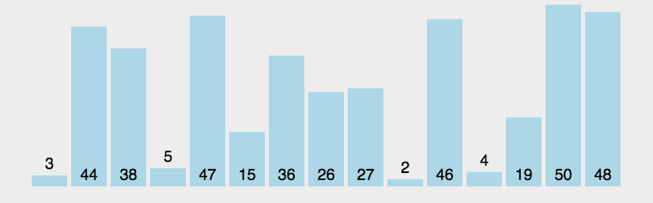

# 冒泡排序

冒泡排序是一种简单的排序算法。它重复地遍历要排序的数列，一次比较两个元素，如果前一个元素大于后一个元素，就交换这两个元素的位置，直到没有再需要交换的元素，也就是说该数列已经排序完成。这个算法的名字由来是因为越小的元素会经过交换慢慢“浮”到数列的最顶端。

## 算法描述

1. 从前往后比较相邻元素，前一个较大时交换。每趟扫描会将未排序区间的最大元素移到末尾。
2. 缩小未排序区间，重复扫描，直到区间只剩一个元素。

## 图示



## Objective-C 示例

```objectivec
- (NSArray *)bubbleSort1WithArray:(NSArray *)unsortArray {
    NSMutableArray *tempArray = unsortArray.mutableCopy;
    for (int i = 0; i < tempArray.count; i++) {
        for (int j = 0; j < tempArray.count; j++) {
            if ([tempArray[i] integerValue] < [tempArray[j] integerValue]) {
                [tempArray exchangeObjectAtIndex:i withObjectAtIndex:j];
            }
        }
    }
    return tempArray.copy;
}

- (NSArray *)bubbleSort2WithArray:(NSArray *)unsortArray {
    NSMutableArray *tempArray = unsortArray.mutableCopy;
    for (int i = 0; i < tempArray.count; i++) {
        for (int j = 0; j < tempArray.count - 1 - i; j++) {
            if ([tempArray[j] integerValue] > [tempArray[j + 1] integerValue]) {
                NSInteger temp   = [tempArray[j] integerValue];
                tempArray[j]     = tempArray[j + 1];
                tempArray[j + 1] = @(temp);
            }
        }
    }
    return tempArray.copy;
}
```

## 稳定性

仅在前一个元素严格大于后一个时交换相邻元素，冒泡排序可以保持相等元素的相对顺序。第二个示例采用相邻比较，第一个示例会交换不相邻的元素，可能改变相等元素的相对顺序。

## 空间复杂度

原地交换只需 `O(1)` 额外空间。示例先复制输入数组，因此需要 `O(n)` 额外空间。

## 时间复杂度

由于是双层 for 循环，所以时间复杂度是 O(n*n)

## 源码

[Xcode 工程](BubbleSort.xcodeproj)
