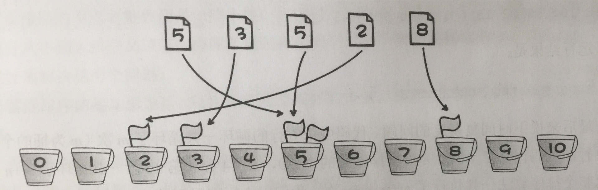

# 桶排序

核心思想是将要排序的数据分到几个有序的桶里，每个桶里的数据再单独进行排序。桶内排完序之后，再把每个桶里的数据按照顺序依次取出，组成的序列就是有序的了。

## 算法描述

- 设置一个定量的数组当作空桶；
- 遍历待排序数据，并且把数据一个一个放到对应的桶里去；
- 对每个不是空的桶进行排序；
- 从不是空的桶里把排好序的数据拼接起来。

## 图示



## Objective-C 示例

```objectivec
- (NSArray *)bucketSortWithArray:(NSArray *)bucketSortArray {
    // 预计每个桶内能装3个
    NSInteger size = 3;
    // 桶的数量
    NSInteger bucketsCount = bucketSortArray.count / size;
    
    // 1.找出数组中最大数和最小数
    NSInteger max = [[bucketSortArray firstObject] integerValue];
    NSInteger min = [[bucketSortArray firstObject] integerValue];
    for (NSNumber *item in bucketSortArray) {
        if ([item integerValue] > max) {
            max = item.integerValue;
        }
        if ([item integerValue] < min) {
            min = item.integerValue;
        }
    }

    // 2.创建桶
    // a.计算桶中数据的平均值，这样分组数据的时候会把数据放到对应的桶中
    float space = (max - min + 1) / (bucketsCount * 1.0);

    NSMutableArray *buckets = [NSMutableArray arrayWithCapacity:bucketsCount];
    for (int i = 0; i < bucketsCount; i++) {
        NSMutableArray *aBucket = [NSMutableArray array];
        [buckets addObject:aBucket];
    }
    // 3.把数据分配到桶中，桶中的数据是有序的
    for (int i = 0; i < bucketSortArray.count; i++) {
        // b.根据数据值计算它在桶中的位置
        int index = floor(([bucketSortArray[i] integerValue] - min) / space);
        NSMutableArray *bucket = buckets[index];
        int maxCount = (int)bucket.count;
        NSInteger minIndex = 0;
        for (int j = maxCount - 1; j >= 0; j--) {
            if ([bucketSortArray[i] integerValue] > [bucket[j] integerValue]) {
                minIndex = j+1;
                break;
            }
        }
        [bucket insertObject:bucketSortArray[i] atIndex:minIndex];
    }
    // 4.把桶中的数据重新组装起来
    NSMutableArray *results = [NSMutableArray array];
    [buckets enumerateObjectsUsingBlock:^(NSArray *obj, NSUInteger idx, BOOL * _Nonnull stop) {
        [results addObjectsFromArray:obj];
    }];
    
    return results;
}
```

## 稳定性

按输入顺序入桶且桶内排序稳定时，桶排序可以保持相等元素的相对顺序。本页示例把新元素插到相等元素之前，因此可能改变它们的相对顺序。

## 空间复杂度

若有 `n` 个元素和 `m` 个桶，额外空间为 `O(n + m)`。
## 时间复杂度

当每个桶的元素数都有常数上界时，时间复杂度为 `O(n + m)`。所有元素集中在同一个桶时，示例中的桶内插入排序最坏需要 `O(n²)` 时间，另需 `O(m)` 创建和遍历桶。

## 源码

[Xcode 工程](BucketSort.xcodeproj)
