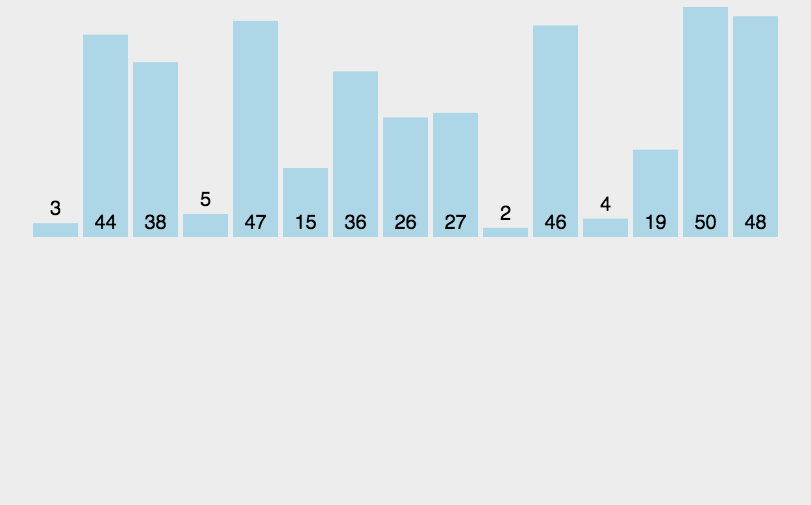

# 插入排序

插入排序的算法描述是一种简单直观的排序算法。它的工作原理是通过构建有序序列，对于待排序数据，在已排序序列中从后向前扫描，找到相应位置并插入。

## 算法描述

一般来说，插入排序都采用 in-place 在数组上实现。具体算法描述如下：

1. 将第一个元素视为已排序区间。
2. 取出下一个元素，从后向前扫描已排序区间，将比它大的元素依次右移。
3. 把新元素插入腾出的位置，重复直到所有元素都进入已排序区间。

## 图示



## Objective-C 示例

```objectivec
- (NSArray *)insertionSortWithArray:(NSArray *)unsortArray {
    NSMutableArray *tempArray = unsortArray.mutableCopy;
    // 移动数据，空出一个适当的位置，把待插入的元素放到里面去。
    for (int i = 0; i < tempArray.count; i++) {
        // temp 为待排元素 i为其位置 j为已排元素最后一个元素的位置（即取下一个元素，在已经排好序的元素序列中从后向前扫描）
        NSNumber *temp = tempArray[i];
        
        int j = i - 1;
        
        // 当j < 0 时， i 为第一个元素 该元素认为已经是排好序的 所以不进入while循环
        while (j >= 0 && [tempArray[j] intValue] > [temp intValue]) {
            //如果已经排好序的序列中元素大于新元素，则将该元素往右移动一个位置
            [tempArray replaceObjectAtIndex:j + 1 withObject:tempArray[j]];
            j--;
        }
        // 跳出while循环时，j的元素小于或等于i的元素(待排元素)。插入新元素 a[j+1] = temp,即将空出来的位置插入待排序的值
        [tempArray replaceObjectAtIndex:j + 1 withObject:temp];
    }
    return tempArray.copy;
}
```

## 稳定性

直接插入排序的过程中，不需要改变相等数值元素的位置，所以它是稳定的算法。

## 空间复杂度

原地插入只需 `O(1)` 额外空间。示例先复制输入数组，因此需要 `O(n)` 额外空间。

## 时间复杂度

如果目标是把 n 个元素的序列升序排列，那么采用插入排序存在最好情况和最坏情况。最好情况就是，序列已经是升序排列了，在这种情况下，需要进行的比较操作需n-1 次即可。最坏情况就是，序列是降序排列，那么此时需要进行的比较共有 n(n-1)/2次 。插入排序的赋值操作是比较操作的次数加上 (n-1）次。平均来说插入排序算法的时间复杂度为 O(n^2）

## 源码

[Xcode 工程](InsertionSort.xcodeproj)
