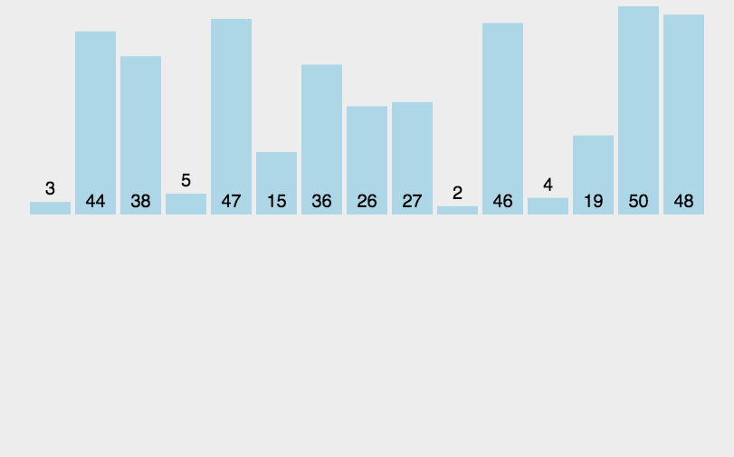

# 归并排序

归并排序采用分治法，先把待排序序列拆分成一个个子序列，直到子序列只有一个元素，停止拆分，然后对每个子序列进行边排序边合并。

## 算法描述

- 把长度为 n 的待排序序列分成两个长度为 n/2 的子序列；
- 然后递归每个子序列，直到子序列只有一个元素；
- 然后对每个子序列进行边排序边合并。

## 图示



## Objective-C 示例

```objectivec
- (NSArray *)mergeSortWithArray:(NSArray *)unSortArray {
    NSInteger len = unSortArray.count;
    // 递归终止条件
    if (len <= 1) {
        return unSortArray;
    }
    NSInteger mid = len / 2;
    // 对左半部分进行拆分
    NSArray *lList = [self mergeSortWithArray:[unSortArray subarrayWithRange:NSMakeRange(0, mid)]];
    // 对右半部分进行拆分
    NSArray *rList = [self mergeSortWithArray:[unSortArray subarrayWithRange:NSMakeRange(mid, len - mid)]];
    // 递归结束后执行下面的语句
    NSInteger lIndex = 0;
    NSInteger rIndex = 0;
    // 进行合并
    NSMutableArray *results = [NSMutableArray array];
    while (lIndex < lList.count && rIndex < rList.count) {
        if ([lList[lIndex] integerValue] < [rList[rIndex] integerValue]) {
            [results addObject:lList[lIndex]];
            lIndex ++;
        } else {
            [results addObject:rList[rIndex]];
            rIndex ++;
        }
    }
    // 把左边剩余元素加到排序结果中
    if (lIndex < lList.count) {
        [results addObjectsFromArray:[lList subarrayWithRange:NSMakeRange(lIndex, lList.count - lIndex)]];
    }
    // 把右边剩余元素加到排序结果中
    if (rIndex < rList.count) {
        [results addObjectsFromArray:[rList subarrayWithRange:NSMakeRange(rIndex, rList.count - rIndex)]];
    }
    return results;
}
```

## 稳定性

归并时，键相等的情况下先取左半边的元素，就能保持稳定性。本页示例在相等时先取右半边，因此可能改变相等元素的相对顺序。

## 空间复杂度

归并需要 `O(n)` 辅助空间，递归栈需要 `O(log n)` 空间，总额外空间复杂度为 `O(n)`。

## 时间复杂度

一趟归并需要将 1～n 个相邻的元素进行两两归并，需要的时间为O(n)，整个归并排序需要进行log₂n 次，因此总的时间复杂度为 O(nlogn)。这是该算法中最好、最坏和平均的时间性能。

## 源码

[Xcode 工程](MergeSort.xcodeproj)
