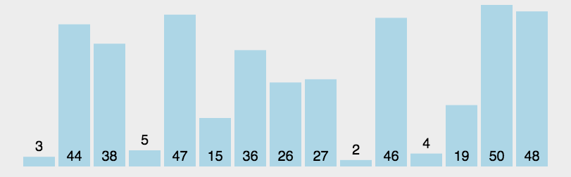

# 快速排序

快速排序围绕一个基准值划分数组，再递归处理划分出的左右区间。

## 算法描述

1. 保存区间首元素作为基准值，将左右游标分别置于区间两端。
2. 从右向左找小于基准的元素，将它填入左侧空位。接着从左向右找大于基准的元素，将它填入右侧空位。
3. 两个游标相遇时，将基准值填入相遇位置，再递归处理两侧区间。

## 图示



## Objective-C 示例

```objectivec
- (void)quickSortArray:(NSMutableArray *)array withLeftIndex:(NSInteger)leftIndex andRightIndex:(NSInteger)rightIndex {
    // 如果数组长度为0或1时返回
    if (leftIndex >= rightIndex) {
        return;
    }
    
    NSInteger i = leftIndex;
    NSInteger j = rightIndex;
    // 记录比较基准数
    NSInteger key = [array[i] integerValue];
    
    while (i < j) {
        /**** 首先从右边j开始查找比基准数小的值 ***/
        // 如果比基准数大，继续查找
        while (i < j && [array[j] integerValue] >= key) {
            j--;
        }
        // 如果比基准数小，则将查找到的小值调换到i的位置
        array[i] = array[j];
        
        /**** 当在右边查找到一个比基准数小的值时，就从i开始往后找比基准数大的值 ***/
        // 如果比基准数小，继续查找
        while (i < j && [array[i] integerValue] <= key) {
            i++;
        }
        // 如果比基准数大，则将查找到的大值调换到j的位置
        array[j] = array[i];
    }
    
    // 将基准数放到正确位置
    array[i] = @(key);
    
    /**** 递归排序 ***/
    // 排序基准数左边的
    [self quickSortArray:array withLeftIndex:leftIndex andRightIndex:i - 1];
    // 排序基准数右边的
    [self quickSortArray:array withLeftIndex:i + 1 andRightIndex:rightIndex];
}
```

## 稳定性

由于“基准”元素(pivot)的比较和交换是跳跃进行的，因此，快速排序是一种不稳定的排序方法。

## 空间复杂度

额外空间主要由递归栈占用。划分均衡时为 `O(log n)`，每次只划分出一个元素时为 `O(n)`。

## 时间复杂度

最好和平均时间复杂度均为 `O(n log n)`，最坏为 `O(n²)`。

## 源码

[Xcode 工程](QuickSort.xcodeproj)
