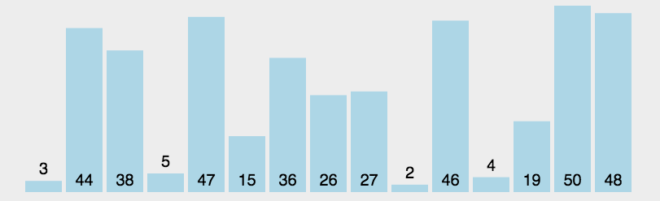

# 选择排序

选择排序是一种简单直观的排序算法，首先在待排序序列中找到最小(大)元素，存放到排序序列的起始位置，然后，再从剩余待排序元素中继续寻找最小(大)元素，然后放到已排序序列的末尾。以此类推，直到所有元素均排序完毕。

## 算法描述

1. 在未排序区间中扫描并记录最小元素的下标。
2. 将最小元素与该区间的首元素交换，再把首元素划入已排序区间。
3. 重复上述步骤，直到未排序区间只剩一个元素。

## 图示



## Objective-C 示例

```objectivec
- (NSArray *)selectSort1WithArray:(NSArray *)unSelectSortArray {
    NSMutableArray *tempArray = unSelectSortArray.mutableCopy;
    for (int i = 0; i < tempArray.count; i ++) {
        NSInteger min = i;
        for (int j = i + 1 ; j < tempArray.count ; j ++ ) {
            if ([tempArray[j] integerValue] < [tempArray[min] integerValue]) {
                min = j;
            }
        }
        [tempArray exchangeObjectAtIndex:i withObjectAtIndex:min];
    }
    return tempArray.copy;
}

- (NSArray *)selectSort2WithArray:(NSArray *)unSelectSortArray {
    NSMutableArray *tempArray = unSelectSortArray.mutableCopy;
    for (int i = 0; i < tempArray.count; i ++) {
        NSInteger min = i;
        for (int j = i + 1 ; j < tempArray.count ; j ++ ) {
            if ([tempArray[j] integerValue] < [tempArray[min] integerValue]) {
                min = j;
            }
        }
        // 交换数据
        if (i != min) {
            NSInteger temp = [tempArray[min] integerValue];
            tempArray[min] = tempArray[i];
            tempArray[i] = @(temp);
        }
    }
    return tempArray.copy;
}
```

## 稳定性

选择排序是不稳定的排序方法。（如序列[5， 5， 3]第一次就将第一个[5]与[3]交换，导致第一个5挪动到第二个5后面）。

## 空间复杂度

原地选择排序只需 `O(1)` 额外空间。示例先复制输入数组，因此需要 `O(n)` 额外空间。

## 时间复杂度

无论输入顺序如何，共需比较 `n(n - 1) / 2` 次。最好、平均和最坏时间复杂度均为 `O(n²)`。

## 源码

[Xcode 工程](SelectionSort.xcodeproj)
