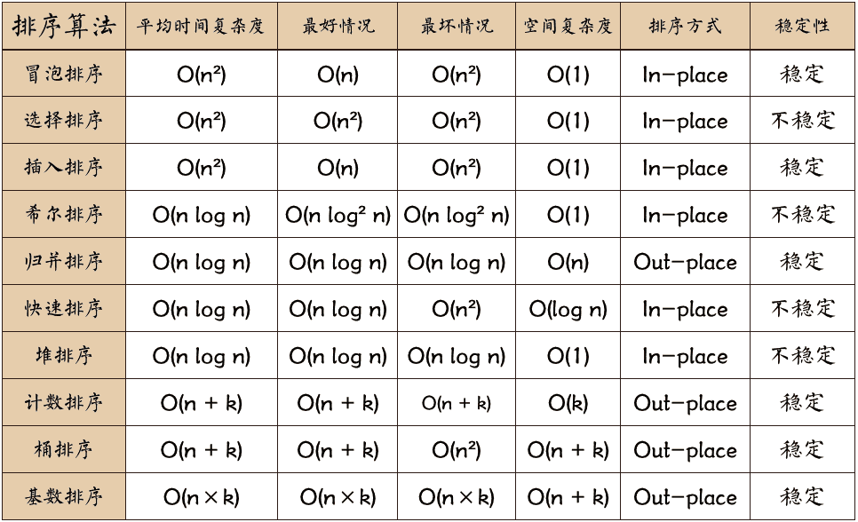

# Play-Leetcode

从一道题练一种解法。这里收录 LeetCode 刷题笔记、Java / Swift / Dart 题解，以及带图示的 Objective-C 排序和数据结构示例。

[按题号查找](#leetcode-题目索引) · [看排序图解](#排序算法) · [看数据结构示例](#数据结构)

## LeetCode 题目索引

点题名查看题目、示例和已有题解。语言列标明可用的源码或内嵌代码。

| 题号 | 题目 | 难度 | 语言与内容 |
| --- | --- | --- | --- |
| 0001 | [两数之和](0001-Two-Sum/README.md) | 简单 | Java、Swift、Dart 源码及题解 |
| 0002 | [两数相加](0002-Add-Two-Numbers/README.md) | 中等 | Java 原地两遍遍历、进位与链表拼接讲解 |
| 0003 | [无重复字符的最长子串](0003-Longest-Substring-Without-Repeating-Characters/README.md) | 中等 | Java、Swift 滑动窗口源码及题解 |
| 0007 | [整数反转](0007-Reverse-Integer/README.md) | 中等 | Java 源码 |
| 0011 | [盛最多水的容器](0011-Container-With-Most-Water/README.md) | 中等 | Java、Swift 源码及题解 |
| 0015 | [三数之和](0015-3Sum/README.md) | 中等 | 题解内含 Swift 和 Java 哈希表示例 |
| 0020 | [有效的括号](0020-Valid-Parentheses/README.md) | 简单 | Java 和 Objective-C 源码、题解 |
| 0021 | [合并两个有序链表](0021-Merge-Two-Sorted-Lists/README.md) | 简单 | Java、Swift 源码及题解 |
| 0026 | [删除有序数组中的重复项](0026-Remove-Duplicates/README.md) | 简单 | Java 源码、题解 |
| 0027 | [移除元素](0027-Remove-Element/README.md) | 简单 | Java 源码、题解 |
| 0028 | [找出字符串中第一个匹配项的下标](0028-Implement-strStr/README.md) | 简单 | Java 源码 |
| 0035 | [搜索插入位置](0035-Search-Insert-Position/README.md) | 简单 | Java 源码、题解 |
| 0042 | [接雨水](0042-Trapping-Rain-Water/README.md) | 困难 | Swift 源码及题解 |
| 0049 | [字母异位词分组](0049-Group-Anagrams/README.md) | 中等 | Java、Swift、Dart 源码及题解 |
| 0058 | [最后一个单词的长度](0058-Length-of-LastWord/README.md) | 简单 | Java 源码 |
| 0066 | [加一](0066-Plus-One/README.md) | 简单 | Java 源码 |
| 0128 | [最长连续序列](0128-Longest-Consecutive-Sequence/README.md) | 中等 | 题解内含 Java 和 Swift 示例 |
| 0142 | [环形链表 II](0142-Linked-List-Cycle-II/README.md) | 中等 | Java 哈希集合、快慢指针源码及推导 |
| 0146 | [LRU 缓存](0146-LRU-Cache/README.md) | 中等 | Java 哈希表与双向链表源码及题解 |
| 0148 | [排序链表](0148-Sort-List/README.md) | 中等 | Java List 排序源码及题解 |
| 0160 | [相交链表](0160-Intersection-of-Two-Linked-Lists/README.md) | 简单 | Java、Swift 哈希集合源码及题解 |
| 0206 | [反转链表](0206-Reverse-Linked-List/README.md) | 简单 | Swift 源码及题解 |
| 0234 | [回文链表](0234-Palindrome-Linked-List/README.md) | 简单 | Swift 数组、快慢指针与原地反转源码及题解 |
| 0242 | [有效的字母异位词](0242-Valid%20Anagram/README.md) | 简单 | 题解内含 Java 示例 |
| 0283 | [移动零](0283-Move-Zeroes/README.md) | 简单 | Java 源码、题解 |
| 0509 | [斐波那契数](0509-Fibonacci-Number/README.md) | 简单 | Java 源码 |

## 排序算法

每篇笔记包含排序步骤、图示、复杂度说明和 Objective-C 示例。

- **比较排序** · [冒泡](Algorithm-Sort/BubbleSort/README.md)、[选择](Algorithm-Sort/SelectionSort/README.md)、[插入](Algorithm-Sort/InsertionSort/README.md)、[希尔](Algorithm-Sort/ShellSort/README.md)、[快速](Algorithm-Sort/QuickSort/README.md)、[归并](Algorithm-Sort/MergeSort/README.md)
- **非比较排序** · [桶排序](Algorithm-Sort/BucketSort/README.md)、[基数排序](Algorithm-Sort/RadixSort/README.md)

## 数据结构

| 主题 | 仓库内容 |
| --- | --- |
| 数组 | [Objective-C 数组示例](Array/Array/Array.xcodeproj)、[删除有序数组中的重复项](Array/RemoveDuplicates/removeDuplicates.md) |
| 栈 | [Objective-C 栈示例](Stack/OC_Stack/Stack.xcodeproj)、[有效的括号](0020-Valid-Parentheses/README.md) |
| 链表 | [LRU 缓存](0146-LRU-Cache/README.md)、[两数相加](0002-Add-Two-Numbers/README.md)、[环形链表 II](0142-Linked-List-Cycle-II/README.md)、[排序链表](0148-Sort-List/README.md)、[相交链表](0160-Intersection-of-Two-Linked-Lists/README.md)、[反转链表](0206-Reverse-Linked-List/README.md)、[回文链表](0234-Palindrome-Linked-List/README.md) |
| 哈希表 | [LRU 缓存](0146-LRU-Cache/README.md)、[两数之和](0001-Two-Sum/README.md)、[三数之和](0015-3Sum/README.md)、[字母异位词分组](0049-Group-Anagrams/README.md)、[有效的字母异位词](0242-Valid%20Anagram/README.md) |

延伸学习主题

- 线性表、双向链表、静态链表、对称矩阵和稀疏矩阵。
- 散列函数、哈希冲突和负载因子。
- 广义栈、链式队列、循环数组队列和双端队列。
- BF、KMP、BM、BM-KMP 和基于有限状态自动机的字符串匹配。
- 二叉树、并查集、哈夫曼树、二叉堆、极大极小堆、双端堆、d 叉堆、左偏堆、斜堆、二项堆、斐波那契堆和配对堆。
- 跳表、二叉搜索树、AVL 树、B 树及其变体、AA 树、红黑树、伸展树、双链树、Trie 树和 R 树。
- 堆排序、计数排序。

## 许可证

[MIT](LICENSE)
